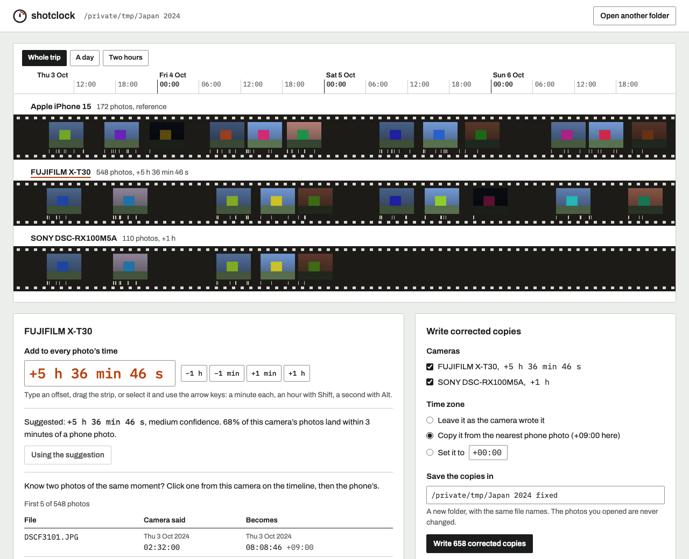

# shotclock

Fixes the dates on photos from a camera whose clock was wrong, so they stop landing in the wrong place in your
albums. Maybe the clock was never set after a battery change, was an hour out after daylight saving, or stayed on
home time for the whole trip. Your phone set its own clock, so the two sets of photos no longer interleave.
shotclock works out how far off the camera was, by lining its bursts of shooting up with the phone's, and writes
corrected copies. Everything runs on your computer and the originals are never touched.



Each camera gets a strip of film with its photos placed at the time they were taken. The phone is the strip on top.
Drag a camera's strip until its photos sit under the phone's, or select it and use the arrow keys (a minute, an hour
with Shift, a second with Alt), or type the offset, or take the suggestion. If you know two photos of the same moment,
click the camera's one and then the phone's. The panel below shows what the first few dates become before anything is
written.

## Run it

You need Rust 1.88 or newer, and Node 22 with pnpm to build the page.

```sh
cd web && pnpm install && pnpm build && cd ..
cargo build --release --features web
./target/release/shotclock-web ~/Pictures/Japan    # then open http://127.0.0.1:7777
./target/release/shotclock-web                     # or type the folder on the page
```

The page is built into the binary, so `shotclock-web` is the only file you need afterwards. It listens on 127.0.0.1
only. Put the camera's photos and the phone's from the same days in one folder first.

The command line version needs no Node, and does nothing but report until you add `--write`:

```sh
cargo build --release
./target/release/shotclock "Japan 2024" --camera sony
```

```
Read 830 photos from Japan 2024 in 0.07 s.
  Apple iPhone 15       172 photos  reference
  FUJIFILM X-T30        548 photos
  SONY DSC-RX100M5A     110 photos

SONY DSC-RX100M5A: suggested offset +1h (medium confidence, 0.48)
  74% of its photos land within 3 minutes of a phone photo.
  Rounded: a whole hour, which is usually daylight saving time.
  Next best: +22h50m.
  DSC01201.JPG  2024-10-03 07:08:01  becomes  2024-10-03 08:08:01
  DSC01202.JPG  2024-10-03 07:09:01  becomes  2024-10-03 08:09:01
  DSC01203.JPG  2024-10-03 07:10:15  becomes  2024-10-03 08:10:15
  DSC01204.JPG  2024-10-03 07:26:05  becomes  2024-10-03 08:26:05
  DSC01205.JPG  2024-10-03 07:26:06  becomes  2024-10-03 08:26:06
  and 105 more

Dry run: nothing was written. Add --write to save corrected copies to Japan 2024 fixed.
```

`--offset +5h37m` (or `-1h`, `-0:30`, `90s`) uses your offset instead of the suggestion. `--pair DSCF3101.JPG
IMG_4000.JPG` takes it from a camera photo and a phone photo of the same moment. `--tz phone` also writes the time
zone, copied from the nearest phone photo, or give one like `--tz +09:00`. `--out` picks the folder for the copies
(by default a new one next to the photos, named "... fixed"), and `--json` prints everything as JSON.

The folder above is made up. `cargo run --release --example make_trip -- "Japan 2024"` writes it: an iPhone with the
right time, a Fujifilm 5 h 37 min behind and a Sony an hour behind, over four days.

## How well it works

There are no real photos in this repo. `examples/bench.rs` simulates trips instead: each day has 6 to 18 moments worth
a photo; at about half of them both the phone and the camera come out, at the rest only one does; cameras shoot
bursts of 2 to 25 frames, phones 1 to 6, and each device starts up to a minute either side of the moment. The phone
also takes a few stray photos a day. Then the camera's clock is set wrong by a known amount and shotclock has to find
it from the times alone.

```sh
cargo run --release --example bench
```

Out of 1,000 trips of 1 to 7 days (57 to 1,432 photos each, median 607), the suggested offset was within a minute of
the truth in:

| Camera clock off by | Within 1 minute |
| --- | --- |
| Any amount up to 20 h | 245 of 250 (98.0%) |
| A whole number of hours, 2 to 12 | 250 of 250 (100%) |
| One hour | 248 of 250 (99.2%) |
| 1 to 15 minutes | 244 of 250 (97.6%) |
| All | 987 of 1,000 (98.7%) |

The confidence shown with each suggestion is worth reading: trips it called high were right every time (591 trips),
medium 99.4% of the time (341), and low 83.8% (68). All 13 misses were trips of one or two days, and 11 of them came
with low confidence.

Timing, on an Apple M4, for a folder of 2,054 test photos (545 phone, 1,509 camera, 13.6 MB): reading the EXIF of
all of them took 67 to 73 ms, the suggestion 7 ms, and writing and checking 1,509 corrected copies 362 to 413 ms,
over three runs. Real photos are bigger, so writing copies will take longer. Reading should stay close, since only
the first 128 KB of each file is read, but I haven't timed it on real files.

To check the copies independently of shotclock's own check, I hashed every byte outside the EXIF segment of the 548
Fujifilm copies and their originals with a separate Python script: all 548 match. On the copy I checked, macOS
(`sips` and Spotlight) reads the corrected capture time and time zone.

## Limits

- JPEG only. HEIC and raw files are listed as skipped. XMP sidecars and XMP dates inside the JPEG are not changed;
  most photo libraries read the EXIF dates first, but some may not.
- One offset per camera for the whole folder. If the clock was changed part way through a trip, split the folder at
  that point and run it twice.
- The suggestion needs the phone and the camera to have been out at some of the same moments. If they never were, it
  says it has nothing to go on or gives a low confidence; type the offset or use a pair of photos.
- The search looks 24 hours either way. If the camera's photos are more than a day away from the phone's (a clock
  reset to 2015, say), it starts from the gap between the middles of the two sets instead. That works when both
  cover the same days of the trip, and is less sure than the normal case.
- The accuracy numbers come from simulated trips, which are tidier than real ones. I haven't measured on real photo
  libraries.
- Two cameras of the same model are only told apart if they write a serial number.
- Picking a pair of photos on the page needs a mouse or touch; the keyboard can nudge and type offsets but not pick.

## How it works

Reading: shotclock walks the JPEG markers to the EXIF segment and reads DateTimeOriginal, CreateDate, the IFD0 date,
OffsetTimeOriginal, Make, Model, the serial number and where the embedded thumbnail is, in either byte order. Photos
are grouped by camera, and the most phone-like camera (a phone maker, and time zones recorded) is the reference.

Suggesting: the photos per minute of each camera are slid along the phone's, a minute at a time across 24 hours either
way, and scored by how well the bursts line up. Counts are squashed with a logarithm so one long burst can't outvote
several short ones. The best minute is then refined by pairing each camera burst with the phone burst that starts
nearest to it and taking the median gap between their first frames. If a whole number of hours, or the gap between
time zones both devices recorded, is within the measurement's own uncertainty, that wins, because that is how clocks
are usually wrong. Confidence is how far the best fit beats the best one more than 15 minutes away, times the share
of camera photos that land near a phone photo.

Writing: an EXIF date is always 19 characters, so a shifted date is written over the old one byte for byte and
nothing else in the file moves. Setting a time zone works the same way when the camera wrote one; when it didn't, the
Exif directory is copied with the new entry to the end of the EXIF segment and the pointer to it updated, so maker
notes and the thumbnail keep their offsets. Each copy goes to a new folder under its original name, never over an
existing file, gets its file time set to the corrected moment, and is read back from disk and its image data hashed
(SHA-256 of everything outside the EXIF segment) against the original before shotclock moves on.

`src/` has one file per step: `exif.rs`, `scan.rs`, `suggest.rs`, `patch.rs`, `write.rs`, `offset.rs`, the CLI in
`main.rs` and the server in `bin/web.rs`. The page is in `web/src`. Design notes are in [DESIGN.md](DESIGN.md).
